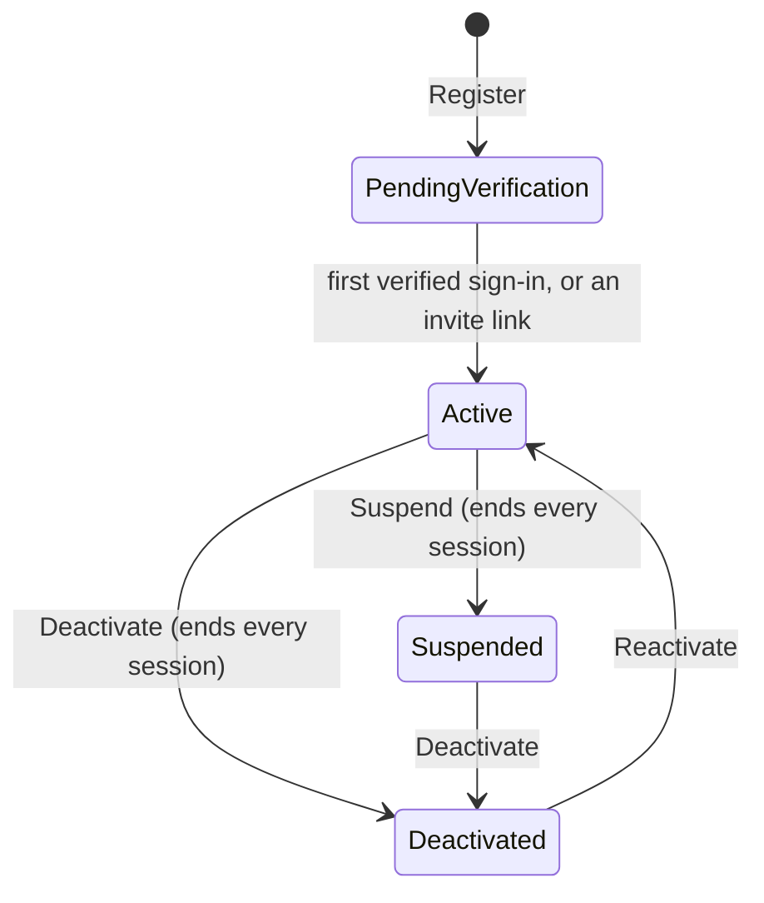
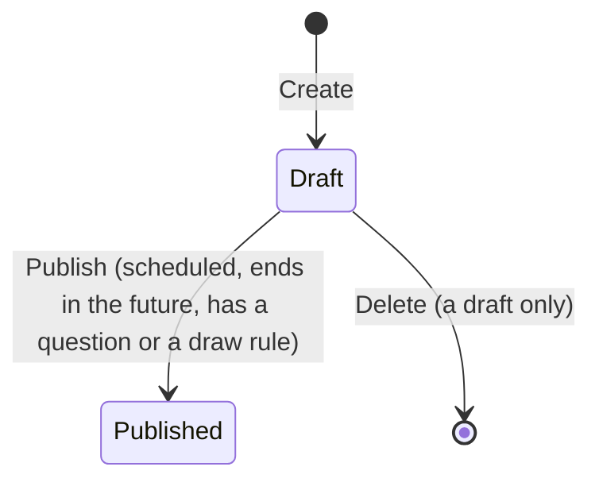
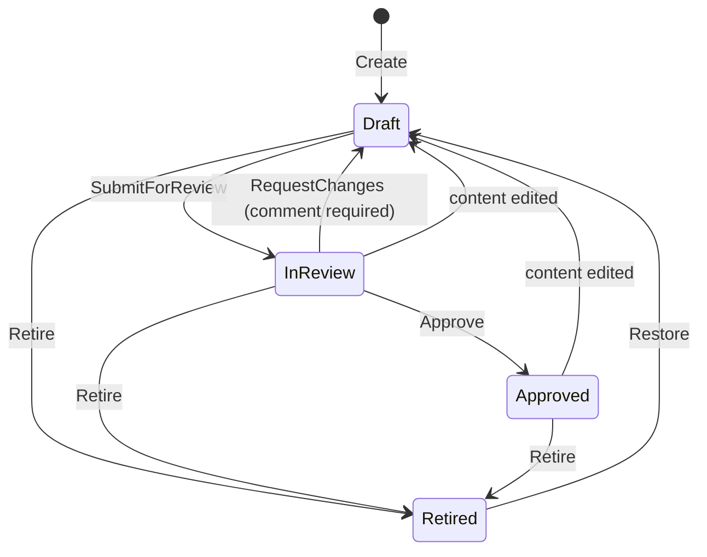
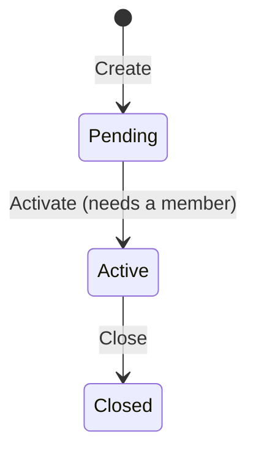
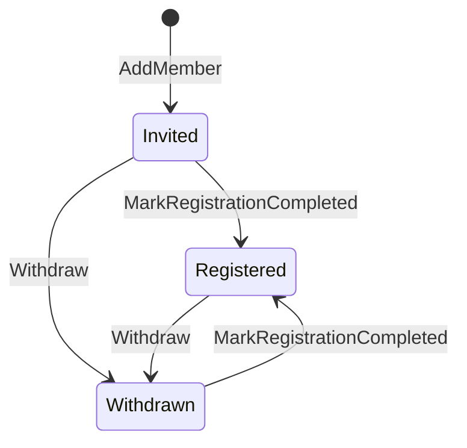
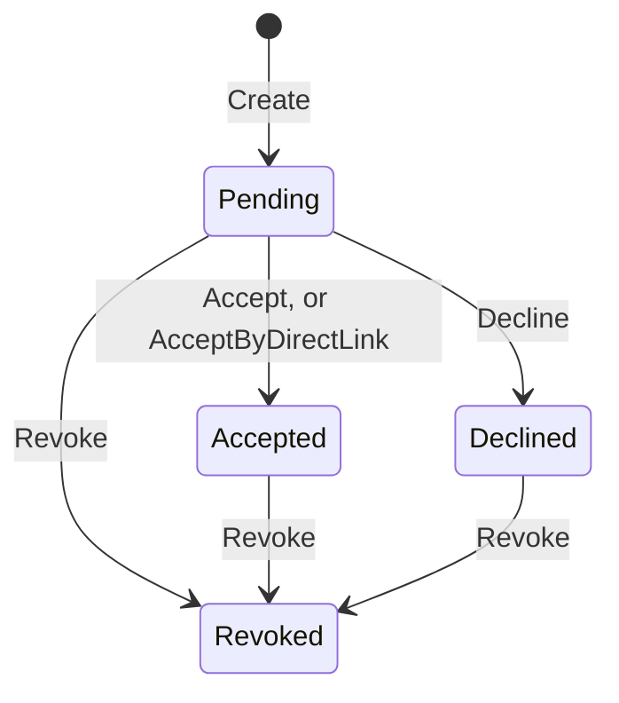
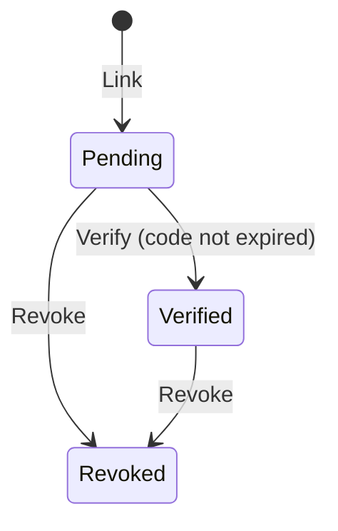
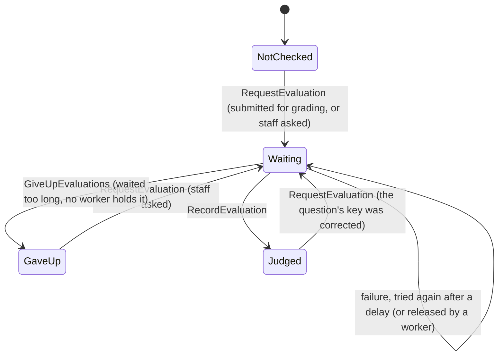
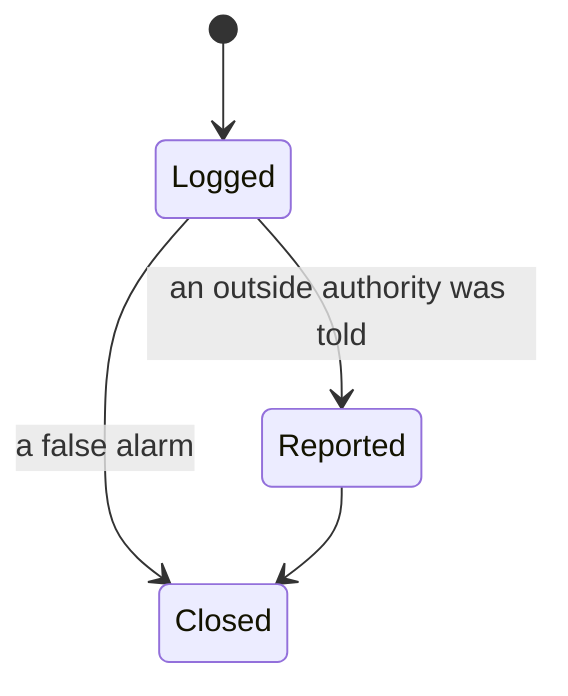

# State machines

Every lifecycle in the platform: what its states are, which moves are allowed, and the one place that enforces them. Read this before you
add a state, add a move, or write a screen that shows or changes one. The decision behind it is
[ADR 0007](./adr/0007-explicit-lifecycles.md). Last checked against the code on 2026-11-09.

**Rules in one breath.** A lifecycle has one status type. Its moves are declared in one place, next to the state, and refused there with a
named error. Anything derived from several fields (a phase, a reason) is computed in one function, never re-derived in a template. The web
app uses the API's state names exactly; a test fails when the two lists differ. A screen's own loading, saving and failed states are
one discriminated union, not a set of booleans.

## Index

| Lifecycle | States | Where the moves are enforced | The web mirror |
| --- | --- | --- | --- |
| [User](#user-account) | PendingVerification, Active, Suspended, Deactivated | `User` (Identity.Domain) | `student-list` reads `Deactivated` |
| [Exam](#exam) | Draft, Published, Archived | `Exam` (ExamAuthoring.Domain) | `ExamStatus` in `exam.models.ts` |
| [Question review](#question-review-fr-8) | Draft, InReview, Approved, Retired | `Question` (QuestionBank.Domain) | `STEPS_BY_STATUS` in `question-review.ts` |
| [Batch](#batch) | Pending, Active, Closed, Archived | `Batch` (Batch.Domain) | `BatchStatus` in `batch.models.ts` |
| [Batch member](#batch-member) | Invited, Registered, Completed, Withdrawn | `BatchMember` | `MemberRegistrationStatus` |
| [Invite](#invite) | Pending, Accepted, Declined, Expired, Revoked | `Invite` (Invite.Domain) | `InviteStatus` |
| [Guardian link](#guardian-link) | Pending, Verified, Revoked | `GuardianLink` | `GuardianLinkStatus` |
| [Attempt](#attempt) | InProgress, Grading, Submitted, plus paused, terminated, invalidated, revising | `Attempt` (ExamRuntime.Domain) | `AttemptStatus`, and flags read by two pages |
| [Typed-answer check](#typed-answer-check-ai-evaluation) | NotChecked, Waiting, Judged, GaveUp | `AttemptAnswer`, read through `TypedAnswerChecks.StateOf` | `AiCheckState` |
| [Decisions on a record](#records-decided-once) | Pending/Open to one outcome | each record's own aggregate | one union per record |
| [Incident](#incident-log) | Logged, Reported, Closed | `Incident.IsAllowedTransition` | none (staff screen reads it) |
| [Timestamp lifecycles](#lifecycles-held-in-timestamps) | OTP, session, consent, notification | each entity's `Is...` members | none |
| [Candidate's exam window](#my-exam-state) | NotOpen, Open, Closed | `MyExamsHandler.StateOf` (derived on read) | `MyExamState` |

## API

### User account

- `Reactivate` changes only a deactivated account; a suspended one stays suspended. `Deactivate` repeated changes nothing.
- `Activate()` has **no guard of its own**. It is safe today because every caller refuses a suspended or deactivated account first
  (`VerifyOtpHandler` through the eligibility policy, `StudentDirectSignIn.EnsureMaySignIn`), and the seeders and provisioning jobs activate
  an account they have just registered.
  A new caller must do the same, or `Activate` should be guarded in the domain (see Open questions).
- Nothing outside the domain calls `Suspend` yet, so no page or endpoint can put an account in `Suspended`.

### Exam

- `Archived` is a name the type reserves. Nothing sets it, though `EnsureNotArchived` already refuses edits to an archived exam.
- Error: `ExamNotDraftError` for a move that needs a draft; `ExamNotDeletableError` for deleting anything else.

### Question review (FR-8)

- An edit that changes nothing is not an edit and does not undo an approval. "Changes" is decided by `ContentFingerprint()`.
- Error: `InvalidQuestionStatusError`. The web's `STEPS_BY_STATUS` offers the buttons; the answer's `status` is authoritative, the page
  does not predict the target.
- Gap: the automatic return to Draft on an edit is not modelled on the web; the page learns it from the response.

### Batch

- `Archived` is reserved; nothing sets it. The batch list words `Pending` as "Draft". No page calls activate or close yet; they are API only.
- Error: `InvalidBatchConfigError` (the same type also carries other batch rules).

### Batch member

- Neither move is guarded: `Withdraw` works from any state, and a withdrawn member who registers becomes `Registered` again. That may be
  intended (a person taken off and re-added), but nothing says so.
- `Completed` is reserved; nothing sets it. The page words Invited as "Pending", Completed as "Verified" and Withdrawn as "Inactive".

### Invite

- `Expired` is reserved; nothing sets it. An invite never expires as a whole; each **code** has its own lifetime (valid until it is used,
  revoked or past `ExpiresAt`), and a pending invite with no valid code is still `Pending`.
- Order of checks matters for privacy: a wrong or used code is refused before the status is revealed, and a wrong address is refused
  before the status on `Decline`. Keep that order.
- Error: `InviteStateError`, `InvalidInviteCodeError`, `InviteEmailMismatchError`.

### Guardian link

- `Verify` checks the status before the expiry, so a link confirmed earlier answers "already confirmed" however old its code is.

### Attempt

An attempt's state is not one field. It is `Status` together with `PausedAtUtc`, `TerminatedByUserId`, `InvalidatedAtUtc`,
`PendingRevisionReason` and the clock (`DeadlineUtc`). The phases they make:

```mermaid
stateDiagram-v2
    [*] --> Running: Start
    Running --> Paused: Pause (administrator)
    Paused --> Running: Resume (deadline moves later by the pause)
    Running --> Submitted: Submit (scored at once)
    Running --> Grading: SubmitForGrading (typed answers to check)
    Running --> Submitted: Terminate (administrator, scored)
    Paused --> Submitted: Terminate
    Running --> Grading: TerminateForGrading
    Grading --> Submitted: ApplyEvaluatedScore (no answer still waiting)
    Submitted --> Revising: RequestReevaluation or RequestAiCheck
    Revising --> Submitted: ApplyEvaluatedScore (score revised, with the reason)
    Submitted --> Invalidated: Invalidate (once; the score is kept for the record)
```

- **Out of time** is not stored. An `InProgress` attempt past its deadline refuses writes (`AttemptTimeExpiredError`), and a `Submit` then
  closes it as an automatic submission at the deadline.
- **Why it ended** is set once, in `Close`: the candidate, the clock (`EndedByClock`), too many page exits (`EndedByViolations`), or an
  administrator (`TerminatedByUserId`). On the candidate's result page an invalidated result replaces the score, and the reason line is, in order: terminated, violations, automatic.
  The administrator's attempt list shows only terminated and "ended automatically", and so words a violation end as automatic. If you add
  a reason, change both pages together, or move the precedence into one function first.
- A paused attempt cannot be submitted by the candidate; only an administrator can end or resume it (`AttemptPausedError`).
- Errors: `AttemptNotInProgressError`, `AttemptPausedError`, `AttemptAlreadyPausedError`, `AttemptNotPausedError`,
  `AttemptTimeExpiredError`, `AttemptNotSubmittedError`, `AttemptBeingGradedError`, `AttemptNotGradingError`,
  `AttemptAlreadyInvalidatedError`.
- Writes to one question's answer are ordered by a sequence number, a separate small machine in its own table ([ADR 0004](./adr/0004-answer-save-sequence-numbers.md)).

### Typed-answer check (AI evaluation)

Held in four nullable timestamps on `AttemptAnswer` and **read** through one function, `TypedAnswerChecks.StateOf`, which is the pattern
this repo prefers: the storage may be several fields, but the reading is one.

Precedence in `StateOf`: Waiting, then GaveUp, then Judged, then NotChecked. Asking again about an answer that is already waiting changes
nothing, so a double click does not throw a check away.

### Records decided once

Each is created open and takes exactly one decision, then stays as a record of who decided and when. Deciding again is refused, never
overwritten. Each enforces it with its own private `Ensure...Open`.

| Record | Moves | Refused with |
| --- | --- | --- |
| Attempt request | Pending to Approved or Declined | `AttemptRequestNotPendingError` |
| Dispute of an answer key (FR-31) | Open to Accepted or Rejected | `DisputeNotOpenError` |
| Issue report (FR-42) | Open to Resolved | `IssueReportNotOpenError` |
| Risk assessment (FR-27) | Open to Reviewed or Dismissed (a dismissal needs a note; only a flagged assessment can be decided) | `RiskFlagAlreadyDecidedError`, `RiskFlagNotRaisedError` |
| Data request (FR-48) | Received to Completed or Rejected (a refusal needs a note) | the aggregate's own error |

### Incident log

The one lifecycle that already keeps its moves as a table, `Incident.IsAllowedTransition`, with every move appended to the history
(`IncidentStatusChange`) and never edited. **Use it as the template for a new lifecycle that needs an audit history.**

### Lifecycles held in timestamps

These have no status column. Their state is which timestamps are set, and each entity exposes it through `Is...` members, so callers never
read the timestamps directly. Keep it that way.

| Entity | States | Read through |
| --- | --- | --- |
| `OtpChallenge` | open, consumed, superseded, locked out (attempts used), expired | `Verify` returns an `OtpVerificationOutcome`; `IsConsumed`, `IsSuperseded` |
| `UserSession` | active, revoked, expired | `IsActive(nowUtc)` |
| `ConsentRecord` | active, withdrawn | `IsActive` |
| `InviteCode` | valid, used, revoked, expired | `IsValid(nowUtc)` |
| `NotificationDelivery` | due, waiting to retry, sent, given up after 5 tries | `IsSettled`, `IsDueAt(nowUtc)` |

### My exam state

`NotOpen`, `Open` and `Closed` are **computed when read** (`MyExamsHandler.StateOf`, from the exam's window and late-entry cutoff) and
sent to the page, which does not recompute them except to show a countdown. Do not store them.

## Web

The web app has no shared state-machine helper and does not need one. The convention is a **discriminated union held in one signal**, as
in the files below, which are the precedents to copy.

Already explicit (copy these): `ConsentState` (`exam-instructions.ts`), `AttentionState` (`admin-attention.service.ts`), `BrandingState`,
`ResultView` (`attempt-result.ts`), `ScreenState` and `WebcamState` (the snapshotters, with a `generation` guard against a stale answer),
`CopyState` (`invite-handover.ts`), `saveState` ('saved' | 'saving' | 'offline') on the attempt page, `AttemptRead` ('loading' | 'failed' | 'idle')
and `SubmitFlow` ('closed' | 'confirming' | 'sending') on the same page, `SyncPhase` ('idle' | 'sending' | 'backoff' | 'disposed') in `answer-sync.ts`, `STEPS_BY_STATUS` (a declared transition table), `groupOf`
(`exam-groups.ts`, pure).

Implicit and worth making explicit, ranked by how much a wrong state costs a candidate. None of these is a known bug; each can show a state
that should be impossible, though on a close reading of the first two no impossible state is reachable today. Do one at a time, behind its
existing spec, and write specs for the states first.

| # | Where | What is implicit |
| --- | --- | --- |
| 1 | `candidate/exam-attempt/exam-attempt.ts` | **Reading and submitting are explicit** (`AttemptRead`, `SubmitFlow`, with the moves written beside them and pinned by specs). Left: the page's phase (open, paused, time up, grading, finished) is still read from `attempt().status`, `pausedAtUtc` and `timeUpNotice`; one `errorMessage` serves a failed load and a failed save; `reload()` can overlap itself, harmlessly today, because every read it makes is of an attempt the server has already ended. No impossible combination of the old flags was reachable, so this was a change in clarity, not a fix. |
| 2 | `candidate/exam-attempt/answer-sync.ts` | **The queue's states are explicit** (`SyncPhase`: idle, sending, backoff, disposed, with the moves beside it; `waiting` is now computed from the failure count, not stored beside it). Left: the page still infers "the queue emptied" and "the connection came back" from two signals in an effect (`hadPendingAnswers`, `wasWaitingForConnection`); that only sets a display time and a screen-reader line, and no edge is missed in practice because a save takes a network round trip. Found on the way: a write that failed after the queue was disposed scheduled a retry timer that nobody cleared; harmless (it fired once and did nothing), and gone now. |
| 3 | `candidate/exam-instructions/exam-instructions.ts` | `canStart` and `startReason` are two encodings of one precedence (checks, problem, acknowledge, consent, starting). `runChecks()` can overlap. |
| 4 | `attempt-management/*-queue`, `proctoring/risk-flag-queue` | The same row machine copied four times: pending, composing, submitting, failed, decided (`busyId`, `rowErrors`, a shared `note`). |
| 5 | `question-bank/question-panel` | new, loading, load failed, ready, saving, repeat warning, save failed, confirming discard: `saving` and `confirmingDiscard` can both be true. |
| 6 | `attempt-management/exam-attempts` | One in-flight action split across `busy`, `rechecking`, `aiChecking`; the third copy of the attempt lifecycle (the action table). |
| 7 | `exam-authoring/exam-editor` | `busy` as a global mutex; `ExamStatus` rules spread over `isDraft`, `canChangeDetails`, `canChangeRelease`, `canPublish`. |
| 8 | `guardian-portal/*` | Plain fields (`loading`, `error`, `success`) in an app with no zone.js, so a redraw depends on something else scheduling it (not checked in a browser); `guardian-dashboard` leaves `loading` true when there is no session. No specs. |
| 9 | the paged lists (`question-picker`, `risk-flag-queue`, `notification-feed`, `question-bank`, `batch-roster`) | `loading`, `loadingMore`, `refreshing`, `failed`, `moreFailed` repeated by hand. |

Not worth touching one by one: the roughly 60 CRUD screens with `loading`/`saving` plus `errorMessage`, and the sign-in form trio
(`submitting`, `errorMessage`, `attempted`). If they ever need one change, add a shared `AsyncState` union and move them together.

## Open questions

These are decisions for the owner, not defects; the code works as it stands.

1. **Reserved states.** `ExamStatus.Archived`, `BatchStatus.Archived`, `InviteStatus.Expired`, `MemberRegistrationStatus.Completed` and
   `UserStatus.Suspended` are never reached. Either build the move or leave the name reserved; do not delete a name, because the status
   is stored by name or number and a stored row must still read.
2. **`User.Activate()` is unguarded** (see User account). A guard would make a reactivated suspended account impossible by construction.
3. **A withdrawn batch member who registers becomes `Registered` again.** Say whether that is wanted.
4. **The administrator's attempt list words a violation end as "ended automatically".** The candidate sees the real reason.

## Changing a lifecycle

1. Change the state type and the guard in the aggregate, and add the move's error type beside the others.
2. If the status reaches the web, change the web union in the same change. `WebStatusVocabularyTests` (in the API's architecture tests)
   fails with both names when they differ; add a row there for a new lifecycle.
3. Update the words in all three languages (`messages.en.ts`, `.hi.ts`, `.mr.ts`); the types make a missing key a compile error.
4. Add the move to the table above and its diagram here, in the same change.
5. A move that was impossible and now is, or the reverse, is a behaviour change. Say so in the commit and test both sides of it.
